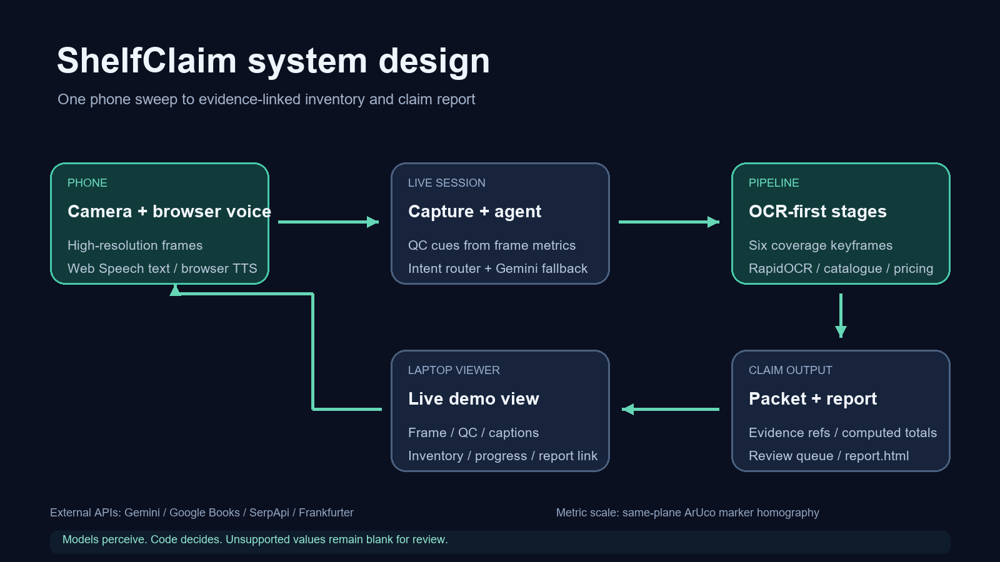

# ShelfClaim

A live voice-and-vision agent that inventories a home library for a contents insurance claim, in one camera sweep.

## How it works

The phone sends high-resolution frames and browser-recognized speech to a local FastAPI server. Deterministic quality checks speak capture cues; RapidOCR finds and reads spine text; catalogue matches and provider-backed offers populate a reviewable claim packet. Models perceive, code decides.



See the [system design page](docs/system-design.html), [architecture overview](docs/architecture.md), and [implemented architecture specification](docs/ARCHITECTURE_SPEC.md).

## Results

| Sweep | Books | Identified | Priced | Used total (INR) | Artifacts |
|---|---:|---:|---:|---:|---|
| `sw_20261126_225839_2007` | 13 | 7 | 5 | ₹4,950.39 | [Report](sweeps/sw_20261126_225839_2007/report.html) · [Packet](sweeps/sw_20261126_225839_2007/claim_packet.json) |
| `sw_20261127_062544_0f69` | 19 | 7 | 5 | ₹3,608.76 | [Report](sweeps/sw_20261127_062544_0f69/report.html) · [Packet](sweeps/sw_20261127_062544_0f69/claim_packet.json) |
| `sw_20261127_044901_65d3` | 11 | 1 | 1 | ₹493.04 | [Report](sweeps/sw_20261127_044901_65d3/report.html) · [Packet](sweeps/sw_20261127_044901_65d3/claim_packet.json) |

These are three saved sweeps, not an accuracy benchmark; identification, pricing, and dimensions still depend on readable text, catalogue connectivity, and visible scale markers.

GitHub shows `report.html` as source. Open it locally in a browser, or visit `http://localhost:8000/sweeps/<id>/` while the server runs.

OCR-first detection raised identification on the same shelf from **4/11** (Gemini spine boxes) to **7/13**.

## Principles

- Models perceive; code decides.
- Every number in the claim has evidence.
- Blank beats wrong: uncertain identity, dimensions, and prices remain empty for review.

## Quickstart

The steps below take under 15 minutes on a configured machine. You need Python 3.12, `uv`, Git, an Android phone with Chrome, and Tailscale for phone access over HTTPS. A printer and ruler are needed for marker-based dimensions.

1. Install dependencies:

   ```powershell
   uv sync --extra dev
   Copy-Item .env.example .env
   ```

   On macOS/Linux, create the file with:

   ```bash
   uv sync --extra dev
   cp .env.example .env
   ```

   Set `GOOGLE_API_KEY` for live voice and `SERPAPI_API_KEY` for book price searches. `GOOGLE_BOOKS_API_KEY` is recommended: keyless Google Books requests can receive HTTP 429 quickly. Open Library is disabled by default because it was unreachable from this network. Keep `.env` private.
2. Download the YuNet face model (Haar detection is used if the model is unavailable):

   ```powershell
   uv run python -m app.cli download-yunet
   ```
3. Generate and print the scale cards at actual size. Measure a printed marker and set `MARKER_SIZE_MM` in `.env` to that measurement:

   ```powershell
   uv run python -m app.cli make-markers --ids 0 1 2 --size-mm 100 --out markers.pdf
   ```
4. Start the server. On Windows:

   ```powershell
   .\tasks.ps1 dev
   ```

   On macOS/Linux:

   ```bash
   uv run uvicorn app.server.main:app --reload --host 0.0.0.0 --port 8000
   ```
5. In another terminal, expose the server to the phone and open the shown HTTPS address in Android Chrome:

   ```bash
   tailscale serve --bg 8000
   ```

   Allow camera and microphone access, place the marker cards on the shelf plane you want measured, and tap **Start**. Open `http://localhost:8000/viewer` on the laptop to see the live viewer. Room dimensions and area are not measured in this build.

## Using it

Tap **Start**, then walk slowly past the shelves while keeping the spines in view. The phone sends video-only camera frames and recognized text; the browser handles speech recognition and TTS. The server stores frame metrics and cues the user about blur, speed, low light, and glare. At the end, confirm completion; the server runs finalization and makes the report available in the viewer.

Common voice inputs include “yes” (locale confirmation), “it's a print”, “not mine”, “how many books”, “which book is this”, “what's it worth”, and “I'm done”. The agent records supported statements, answers status questions from tools, and uses scripted responses for title/price questions during capture.

Useful CLI commands:

```bash
# Resume processing at identification and build through the report
uv run python -m app.cli replay sweeps/<sweep-id> --from-stage s06 --until s10 --limit 10

# Compare a sweep with the labelled ground truth
uv run python -m app.cli evaluate --sweep sweeps/<sweep-id> --gt eval/ground_truth --out docs/results.md

# Search up to ten provider offers
uv run python -m app.cli reprice --sweep sweeps/<sweep-id> --country GB --limit 10

# Try a text conversation or a scripted session with saved frames
uv run python -m app.cli agent-chat
uv run python -m app.cli agent-soak --turns 20 --with-frames sweeps/sw_20261126_225839_2007
```

Live API calls depend on provider availability and quota. Use fixtures for routine tests; replay and reprice may call external services when cache entries are absent.

## Repository layout

```text
app/             FastAPI server, capture, live agent, pipeline, packet, and providers
web/             Phone app and laptop live viewer (vanilla JavaScript)
config/          Capture, detection, locale, pricing, and model settings
scripts/         Small diagnostic/reproduction scripts
tests/           Unit and browser speech tests with mocked services
eval/            Ground-truth files and evaluation inputs
docs/            Product references, architecture, decisions, results, and deliverables
sweeps/          Three committed demo sweeps with frames, packets, and reports
```

## Tech stack & services

| Technology/service | Used for |
|---|---|
| Web Speech API | Browser speech recognition; raw microphone audio is not uploaded. |
| Gemini Flash-Lite | Live agent responses and explicit tool calls; optional vision fallback/assist is disabled by the current settings. |
| RapidOCR + ONNX Runtime | Local CPU book-spine text detection and transcription. |
| OpenCV / YuNet | Frame quality, ArUco markers, and face redaction; Haar is the face-detection fallback. |
| Google Books | Catalogue candidates and ISBN metadata; its sale prices are not used. |
| SerpApi Google Shopping and eBay | New and used physical-book offers with source URLs and saved responses. |
| Frankfurter | Currency conversion for used UK offers priced in INR. |
| Tailscale | HTTPS access from the phone to the local server. |

## Reference app: kept, changed, threw away

- **Kept:** voice-and-camera intake, browser↔server WebSocket shape, non-blocking tools, “say only what you see” honesty, and mocked-model tests.
- **Changed:** added a separate high-resolution capture channel because the reference’s 512 px/1 fps stream cannot reliably read spines; made the agent a sweep director driven by measured QC cues; replaced the ADK graph with a staged, file-based pipeline.
- **Threw away:** policy lookup, incident sketches, avatar, and notebook-style packet.

## AI tools used

Codex for implementation; Claude for planning documents and debugging guidance.

## Limitations & next steps

Spine boxes can split or merge neighboring text; the three demo sweeps do not establish accuracy against a complete ground-truth set. Room area is unmeasured, and the current OCR-first path does not detect non-book items for pricing. See the [failure log](docs/failure_log.md) for known failure modes and follow-up work.

## Assumptions

India/INR is the primary locale and UK/GBP is the second. Printed ArUco cards are the metric anchor; dimensions remain null without same-plane marker evidence. Prices use filtered provider offers, while unidentified books stay blank. See [recorded decisions](docs/DECISIONS.md) and [planning assumptions](docs/planning/01_PROBLEM_BREAKDOWN.md).

## Deliverables

- Demo video: **VIDEO_LINK**
- [Packets and reports](#results)
- [Evaluation/results notes](docs/results.md)
- [Architecture](docs/architecture.md) · [Implemented specification](docs/ARCHITECTURE_SPEC.md)
- [System design page](docs/system-design.html) · [System design image](docs/images/system-design.png)
- [Failure log](docs/failure_log.md)
- [Assumptions and decisions](docs/DECISIONS.md)
