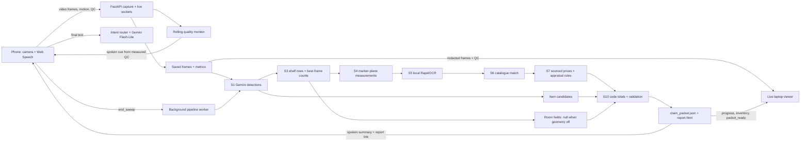

# ShelfClaim architecture

Models perceive; deterministic application code decides packet values. The browser sends final speech text and video-only capture frames; raw mic audio remains in browser speech recognition.

## Models and tools

`AGENT_MODEL` defaults to `gemini-3.1-flash-lite` for conversation and function calls. Deterministic intent handlers cover common sweep actions. `VISION_MODEL` defaults to `gemini-3.5-flash-lite` for detections; local RapidOCR with ONNX Runtime reads spine text without Gemini quota. OpenCV handles image processing and YuNet face boxes. Google Books is the primary catalogue for title/author/ISBN metadata, with Open Library as an enabled fallback. Google Books `saleInfo` is ignored for pricing.

The quality monitor derives blur, exposure, glare, and motion from saved frame metrics. Supported cues are spoken directly by browser TTS; they do not pass through the LLM. Detection runs post-capture in this build, so detection-dependent cues and live provisional inventory are not wired into capture.

## Measurement and price evidence

Book dimensions use an ArUco marker-plane homography. The printed marker size (`MARKER_SIZE_MM`, set from a ruler measurement) supplies metric scale; a marker must be on the same unit and plane as the book. Without that evidence, dimensions stay null. `GEOMETRY_BACKEND=off` leaves room dimensions, floor area, and wall area null; there is no room reconstruction in this build.

New offers come from SerpApi Google Shopping; used offers come from the SerpApi eBay engine. The pipeline filters physical books and mismatched titles, rejects IQR outliers, and takes the median. Frankfurter provides documented FX conversion for cross-market used prices. Locale appraisal rules suppress prices for signed, first-edition, rare, or art lines when applicable. Raw provider responses are saved as evidence snapshots. Settings list optional eBay Browse credentials/provider selection, but this repository has no Browse provider implementation; the run used SerpApi eBay.

Totals are computed by `app/packet/totals.py`, never by a model. The validation gate checks frame references, price evidence, and recomputed totals before the report is ready.

## Runtime status

The phone capture and agent sockets run during a sweep. `end_sweep` starts the same `run_pipeline` function used by CLI replay in a worker thread; stage progress and final inventory are broadcast to the phone and laptop viewer. CLI replay remains available for recovery and repeatable analysis. The latest S06–S10 replay passed validation on three selected shelf frames, with 11 book rows, 4 identified, and 4 used-price offers. Per-stage timing and provider cost are included only when recorded in telemetry; see [results](results.md) and [failure log](failure_log.md).
