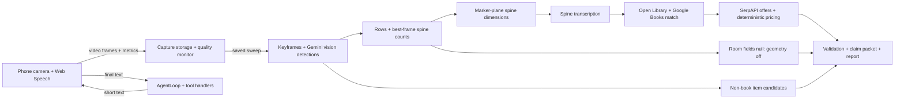

# ShelfClaim architecture

ShelfClaim separates perception from decisions. Browser speech recognition sends final text over `/ws/live`; the server agent uses function calls for sweep control and responses, and browser speech synthesis speaks replies and deterministic capture cues. The capture WebSocket stores video-only frames and quality metrics. It does not stream microphone audio.

## Models and evidence

`AGENT_MODEL` defaults to `gemini-3.1-flash-lite` for short conversation. `VISION_MODEL` defaults to `gemini-3.5-flash-lite` for structured detections and spine transcription. The model proposes boxes or visible text; deterministic code performs pixel conversion, NMS, row assignment, measurements, catalogue matching, filters, price aggregation, and totals. Titles enter the packet only after catalogue matching. Prices come only from parsed provider offers and require a source URL, retrieval time, and saved response snapshot.

Spine measurements use a planar homography only when an ArUco marker is visible on the same shelf unit and plane as the book. The known marker size (`MARKER_SIZE_MM`) defines that metric scale. Without a valid same-plane marker, dimensions are null with a review reason. This is not room reconstruction: with `GEOMETRY_BACKEND=off`, room dimensions, floor area, and wall area remain null.

New book prices use SerpAPI Google Shopping. Used offers use the SerpAPI eBay engine; cross-market GBP quotes for India use Frankfurter conversion. The optional eBay Browse provider remains available. Physical-item filters, title matching, IQR outlier rejection, median calculation, locale appraisal rules, and item ranges are deterministic. Raw provider responses are saved under sweep evidence.

## Current run status

The live S1 replay returned HTTP 503 `UNAVAILABLE`; downstream detections and a final packet were not produced. The demo and latest sweeps contain only capture records, so no book count, identified title, price, dimension, or room-area result is claimed. See [results](results.md) and [failure log](failure_log.md). The implementation currently runs detection after capture; streaming detections and provisional inventory are not wired into the live session.
